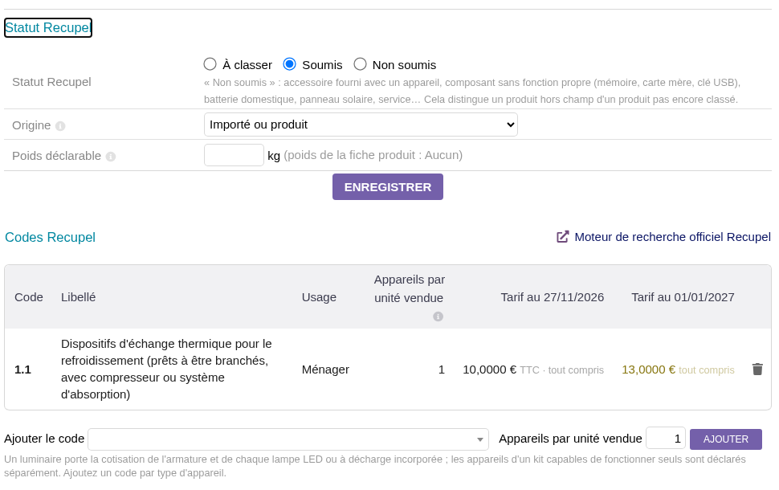
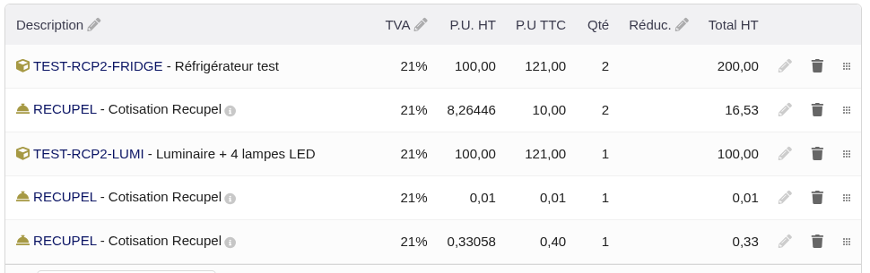
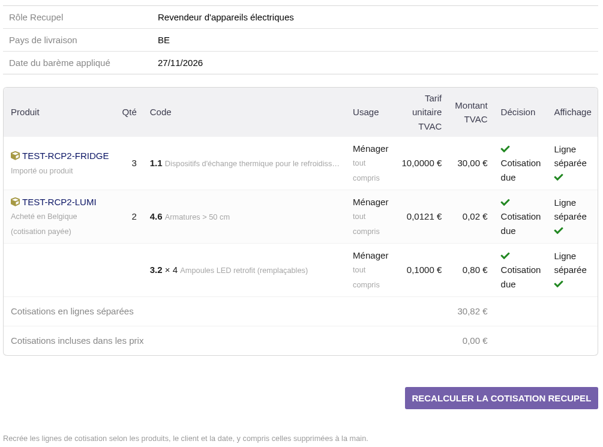
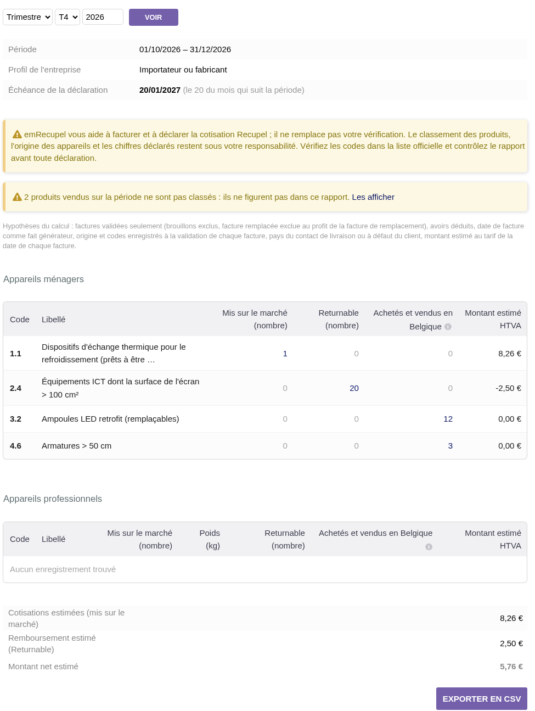
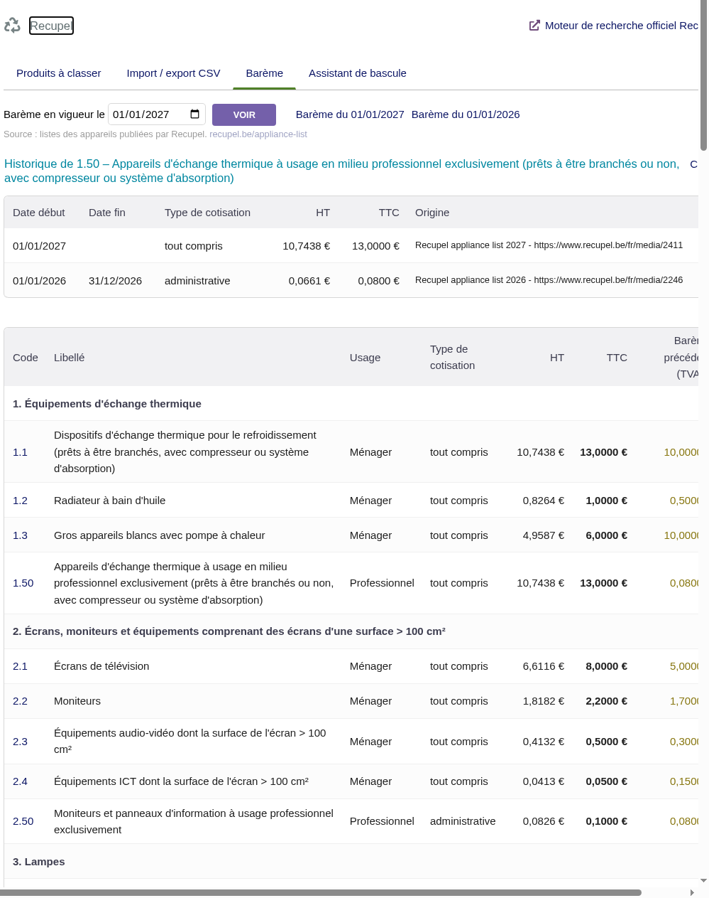
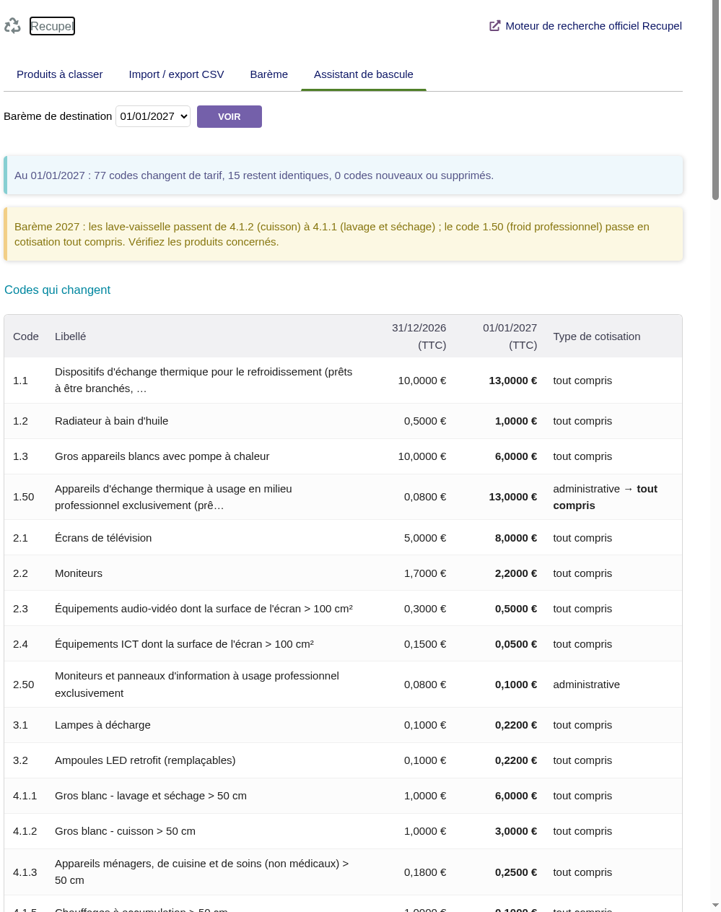

# emRecupel — cotisation Recupel pour Dolibarr

[](LICENSE)
[](https://www.dolibarr.org)
[](https://www.php.net)
[](https://github.com/momodemo333/emrecupel/releases/latest)

**emRecupel** ajoute à Dolibarr ERP/CRM la **cotisation Recupel** belge
(éco-contribution sur les équipements électriques et électroniques, DEEE) :
sur les devis, commandes, factures et avoirs, avec les barèmes officiels 2026
et 2027, les règles d'affichage légales et un rapport qui prépare la
déclaration Recupel.

Libre et gratuit (GPL v3). 🇬🇧 [Read in English](README.md)

> **Avertissement.** emRecupel aide à calculer la cotisation et à préparer la
> déclaration ; il ne remplace pas votre vérification. Le classement des
> produits, leur origine et les chiffres déclarés restent sous votre
> responsabilité. Ce projet n'est ni affilié à Recupel ni approuvé par Recupel.

## Pour qui ?

Les entreprises belges qui vendent des équipements électriques et électroniques
avec Dolibarr :

- **revendeurs** qui achètent chez des fournisseurs belges et répercutent la
  cotisation ;
- **revendeurs qui exportent** et se font rembourser la cotisation
  (« Returnable ») ;
- **importateurs et fabricants**, membres Recupel, qui déclarent les appareils
  mis sur le marché belge.

## Fonctionnalités

- **Barèmes officiels 2026 et 2027** (92 codes, libellés officiels FR/NL/EN,
  montants TVAC et HTVA), datés : la cotisation suit la date du document, la
  bascule du 1er janvier 2027 est automatique. Barèmes contrôlés code par code
  contre les listes officielles ([contrôle](docs/SCALE-VERIFICATION.md)).
  Import CSV d'un nouveau barème, historique par code, **assistant de bascule**
  (codes, produits, devis et commandes ouverts concernés).
- **Classement des produits** : un ou plusieurs codes avec une quantité
  (luminaire + lampes, kits), statut « non soumis », origine (importé ou
  produit / acheté en Belgique / occasion belge), poids déclarable. Écran de
  classement en masse et import/export CSV (`ref;code;quantité;origine`).
- **Règles d'affichage** (FAQ Recupel 2.13) :

  | Client | Cotisation tout compris (ménager) | Appareil professionnel |
  |---|---|---|
  | Revendeur d'appareils électriques (BE) | Ligne séparée (obligatoire) | Incluse (réglable) |
  | Utilisateur final, entreprise ou particulier (BE) | Incluse, montant sous la ligne (réglable) | Incluse (réglable) |
  | Hors Belgique | Pas de cotisation | Pas de cotisation |

  Trois rendus : ligne de cotisation sous le produit ; « incluse » avec le
  montant sous la ligne et le total en pied de PDF ; total en pied seulement.
  Rôle et affichage réglables par client. Modèles PDF standards.
- **Tous les documents de vente** : devis, commandes, factures, avoirs,
  factures de remplacement, clones, factures modèles (récurrentes) — aucun
  doublon à la conversion, négatif sur les avoirs, documents validés jamais
  modifiés.
- **TVA** de la cotisation = TVA de la ligne produit (code TVA complet) ;
  option base TVAC pour payer le montant rond officiel (10,00 € et non 9,99 €).
- **Rapport de déclaration** : mois, trimestre ou année ; blocs ménager et
  professionnel ; colonnes « mis sur le marché » (nombre, et poids pour le
  professionnel) et « Returnable » ; montant estimé ; plafond des cotisations
  administratives ; échéance ; détail jusqu'aux factures ; export CSV. Un
  revendeur pur obtient un état de contrôle.
- Français, néerlandais, anglais ; multi-société ; droits.

## Captures d'écran

| | |
|---|---|
|  |  |
| Onglet Recupel d'un produit | Lignes de cotisation, facture à un revendeur |
|  |  |
| Analyse Recupel d'un document | Rapport de déclaration |
|  |  |
| Barème et historique d'un code | Assistant de bascule 2027 |

## Installation

Prérequis : Dolibarr **21 ou plus récent** (testé sur 23.0.1 et 21.0.1), PHP
**8.1 ou plus récent** (testé en 8.1 et 8.2), MySQL ou MariaDB (PostgreSQL non
pris en charge).

1. Télécharger `module_emrecupel-X.Y.Z.zip` depuis la
   [dernière version](https://github.com/momodemo333/emrecupel/releases/latest)
   et le décompresser dans `htdocs/custom/` (on obtient
   `htdocs/custom/emrecupel/`), ou :
   ```bash
   git clone https://github.com/momodemo333/emrecupel.git htdocs/custom/emrecupel
   ```
2. *Configuration › Modules › Modules financiers* : activer **emRecupel**.
   Tables, champs, service RECUPEL et barèmes 2026/2027 sont créés
   automatiquement.
3. Configuration du module : profil de l'entreprise, matrice d'affichage.
4. Classer les produits (*Produits › Recupel › Produits à classer*, ou import CSV).

Mise à jour : remplacer le dossier ; les migrations de la base se lancent au
chargement de page suivant. Détails : [docs/INSTALL.md](docs/INSTALL.md).

## Documentation

- [Guide utilisateur (FR)](docs/USER-GUIDE.md) · [User guide (EN)](docs/USER-GUIDE-EN.md)
- [Installation (FR)](docs/INSTALL.md) · [Installation (EN)](docs/INSTALL-EN.md)
- [FAQ (FR)](docs/FAQ.md) · [FAQ (EN)](docs/FAQ-EN.md)
- [Contrôle des barèmes](docs/SCALE-VERIFICATION.md) · [Changelog](CHANGELOG.md)
- Documentation en ligne : https://www.e-dem.com/fr/docs/emrecupel

## Limites connues et points ouverts

- Hors 2.0.0 : Bebat et autres éco-contributions, documents d'achat et contrôle
  des cotisations fournisseurs, comportement spécifique TakePOS, mise à jour des
  barèmes par flux en ligne, « gel » d'une déclaration envoyée, export XLSX.
- Points que Recupel ne tranche pas explicitement (le module documente son
  choix) : avoirs pour retour en Belgique (déduits sur la période de l'avoir),
  montant à afficher pour un stock 2026 vendu en 2027 par un revendeur (tarif à
  la date du document), cotisations administratives d'appareils professionnels
  exportés (comptés en Returnable sans montant remboursé).
- La mention « incluse » est masquée si l'option PDF « masquer la description »
  est active.
- Testé sur Dolibarr 21 et 23 seulement.

## Contribuer

Les issues et pull requests sont bienvenues — voir
[CONTRIBUTING.md](CONTRIBUTING.md). Failles de sécurité : voir
[SECURITY.md](SECURITY.md).

## Licence et auteur

GPL-3.0-or-later — voir [LICENSE](LICENSE).

**Morgan Demoulin — [E-dem](https://www.e-dem.com/fr/produits/emrecupel)**,
intégrateur Dolibarr. Support commercial, installation et développements sur
mesure possibles via E-dem.
