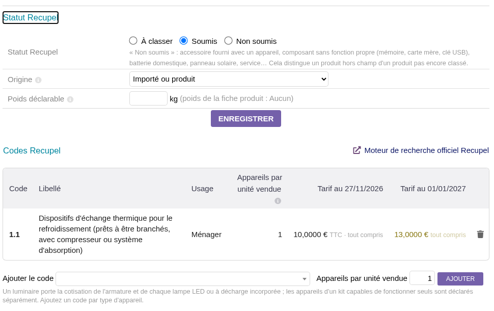
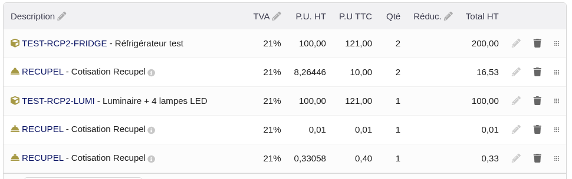
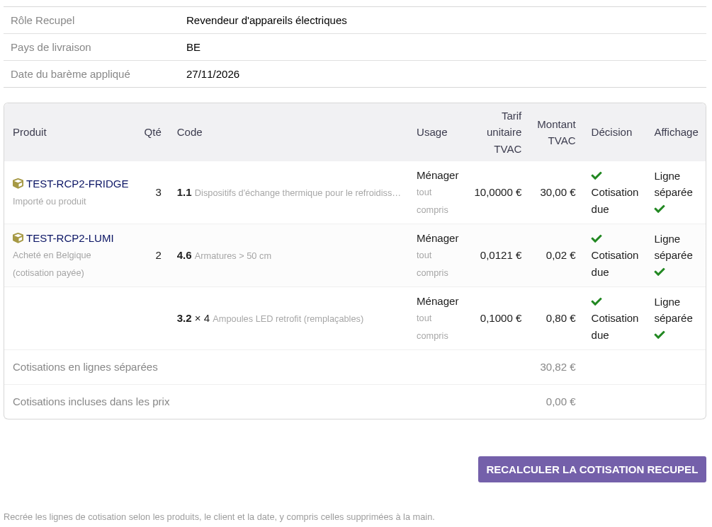
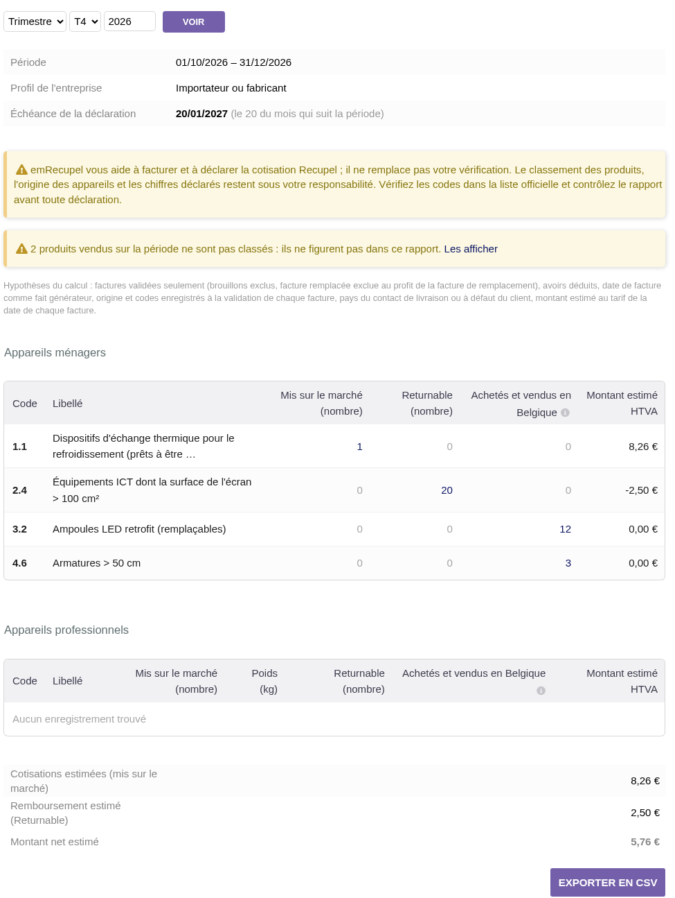
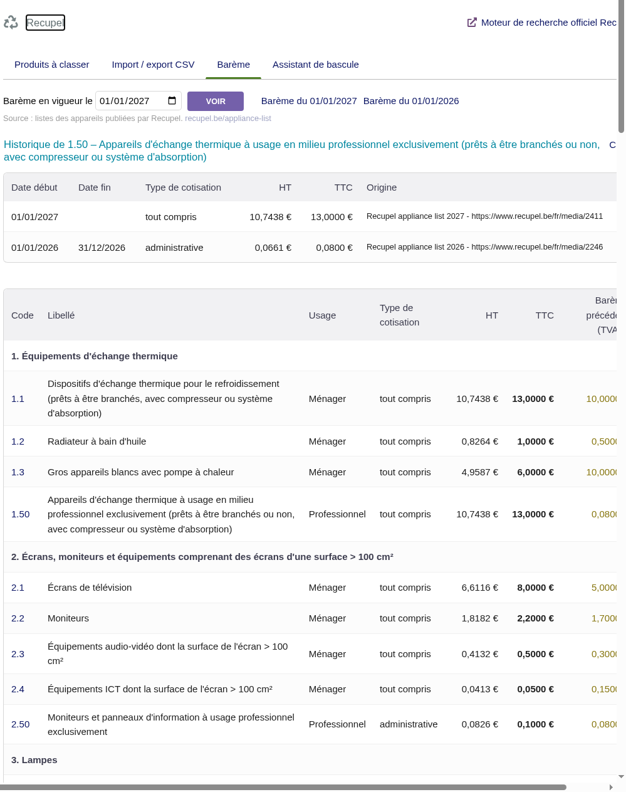
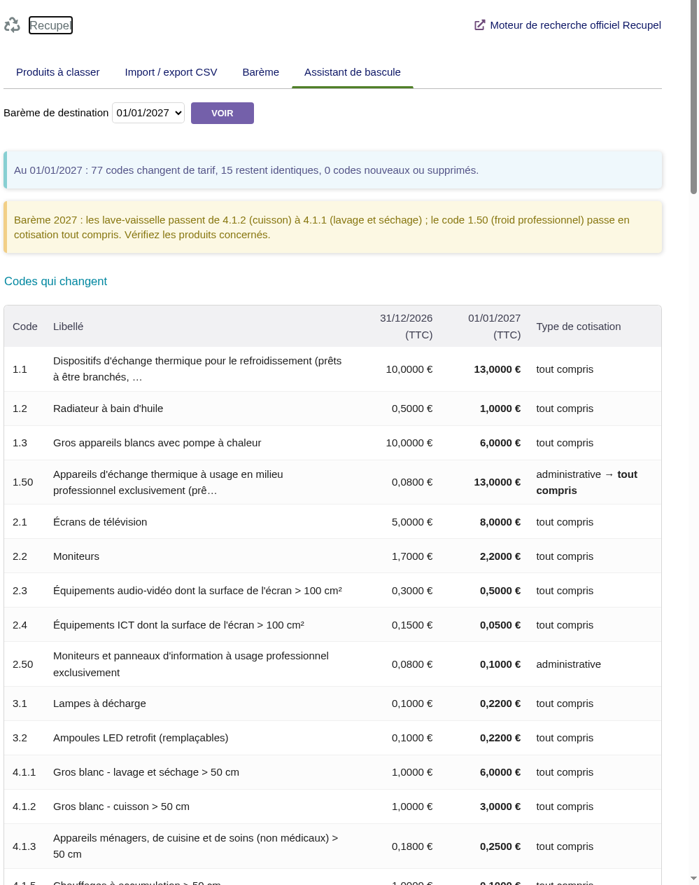

# emRecupel — Recupel fee for Dolibarr

[](LICENSE)
[](https://www.dolibarr.org)
[](https://www.php.net)
[](https://github.com/momodemo333/emrecupel/releases/latest)

**emRecupel** adds the Belgian **Recupel fee** (the WEEE eco-contribution on
electrical and electronic equipment) to Dolibarr ERP/CRM: on proposals, orders,
invoices and credit notes, with the official 2026 and 2027 scales, the legal
display rules, and a report that prepares the Recupel declaration.

Free and open source (GPL v3). 🇫🇷 [Lire en français](README.fr.md)

> **Disclaimer.** emRecupel helps you compute the fee and prepare your
> declaration; it does not replace your own check. You remain responsible for
> the classification of your products, their origin and the figures you
> declare. This project is not affiliated with or endorsed by Recupel.

## Who is it for?

Belgian companies that sell electrical and electronic equipment (EEE) with
Dolibarr:

- **retailers** who buy from Belgian suppliers and pass the fee on to their
  customers;
- **retailers who export** and claim the fee back ("Returnable");
- **importers and manufacturers**, Recupel members who declare the appliances
  they place on the Belgian market.

## Features

- **Official scales 2026 and 2027** (92 codes, official FR/NL/EN labels, amounts
  incl. and excl. VAT), dated: the fee follows the date of the document, the
  switch on 1 January 2027 is automatic. Scales checked code by code against the
  official Recupel lists ([verification](docs/SCALE-VERIFICATION.md)). A new
  scale can be imported as CSV; history per code; **switch assistant** listing
  the codes, products and open proposals/orders affected.
- **Product classification**: one or more Recupel codes per product with a
  quantity (luminaire + lamps, kits), "not subject" status, origin (imported or
  produced / bought in Belgium / Belgian second-hand), declarable weight. Bulk
  classification screen and CSV import/export (`ref;code;quantity;origin`).
- **Legal display rules** (Recupel FAQ 2.13):

  | Customer | All-in fee (household appliances) | Professional appliance |
  |---|---|---|
  | Reseller of electrical appliances (BE) | Separate line (mandatory) | Included (configurable) |
  | End user, company or consumer (BE) | Included, amount under the line (configurable) | Included (configurable) |
  | Outside Belgium | No fee | No fee |

  Three renderings: separate fee line under the product; "fee included" with the
  amount under the line and a total in the PDF footer; footer total only. Role
  and display override per customer. Works with the standard PDF models.
- **All sales documents**: proposals, orders, invoices, credit notes,
  replacement invoices, clones, template (recurring) invoices — no duplicate
  fee on conversion, negative on credit notes, validated documents never
  changed.
- **VAT** of the fee = VAT of the product line (full VAT code); optional
  VAT-inclusive pricing so the customer pays the round official amount
  (€ 10.00, not € 9.99).
- **Declaration report**: month, quarter or year; household and professional
  blocks; "brought to market" (number, and weight for professional appliances)
  and "Returnable" columns; estimated amount; administrative fee cap; deadline;
  drill-down to the invoices; CSV export. A pure retailer gets a control
  statement instead of a declaration.
- French, Dutch and English; multi-company; permissions.

## Screenshots

| | |
|---|---|
|  |  |
| Recupel tab of a product | Fee lines on an invoice to a reseller |
|  |  |
| Recupel analysis of a document | Declaration report |
|  |  |
| Scale and history of a code | 2027 switch assistant |

## Installation

Requirements: Dolibarr **21 or later** (tested on 23.0.1 and 21.0.1), PHP
**8.1 or later** (tested on 8.1 and 8.2), MySQL or MariaDB (PostgreSQL is not
supported).

1. Download `module_emrecupel-X.Y.Z.zip` from the
   [latest release](https://github.com/momodemo333/emrecupel/releases/latest) and
   unzip it into `htdocs/custom/` (you get `htdocs/custom/emrecupel/`), or:
   ```bash
   git clone https://github.com/momodemo333/emrecupel.git htdocs/custom/emrecupel
   ```
2. *Setup › Modules › Financial modules*: enable **emRecupel**. Tables, fields,
   the RECUPEL fee service and the 2026/2027 scales are created automatically.
3. Module setup: choose your company profile and check the display matrix.
4. Classify your products (*Products › Recupel › Products to classify*, or CSV
   import).

Updates: replace the folder; database migrations run by themselves on the next
page load. Details: [docs/INSTALL-EN.md](docs/INSTALL-EN.md).

## Documentation

- [User guide (EN)](docs/USER-GUIDE-EN.md) · [Guide utilisateur (FR)](docs/USER-GUIDE.md)
- [Installation (EN)](docs/INSTALL-EN.md) · [Installation (FR)](docs/INSTALL.md)
- [FAQ (EN)](docs/FAQ-EN.md) · [FAQ (FR)](docs/FAQ.md)
- [Scale verification](docs/SCALE-VERIFICATION.md) · [Changelog](CHANGELOG.md)
- Online documentation: https://www.e-dem.com/en/docs/emrecupel

## Known limits and open points

- Not included in 2.0.0: Bebat and other eco-contributions, purchase documents
  and control of supplier fees, TakePOS-specific behaviour, scale updates
  through an online feed, "freeze" of a submitted declaration, XLSX export.
- Points Recupel does not settle explicitly (the module documents its choice):
  credit notes for returns in Belgium (deducted in the period of the credit
  note), the amount to show for 2026 stock sold in 2027 by a retailer (rate at
  the document date), administrative fees of exported professional appliances
  (counted as Returnable without refund amount).
- The "fee included" mention is hidden when the PDF option "hide description"
  is on.
- Tested on Dolibarr 21 and 23 only.

## Contributing

Issues and pull requests are welcome — see [CONTRIBUTING.md](CONTRIBUTING.md).
Security issues: see [SECURITY.md](SECURITY.md).

```bash
composer install                                   # PHPUnit (dev only)
php vendor/bin/phpunit -c phpunit.xml.dist         # unit tests
php tests/Integration/run_integration.php --rollback   # integration tests on a Dolibarr database
make lint && make build-release                    # zip in dist/
```

## Nederlands

**emRecupel** voegt de Belgische **Recupelbijdrage** toe aan Dolibarr: op
offertes, bestellingen, facturen en creditnota's, met de officiële
tarieflijsten 2026 en 2027, de wettelijke weergaveregels (aparte lijn voor
verdelers, "bijdrage inbegrepen" voor eindgebruikers, geen bijdrage buiten
België) en een rapport dat de Recupel-aangifte voorbereidt. Vrije software
(GPL v3), volledig vertaald in het Nederlands. De module helpt u berekenen en
aangeven; u blijft verantwoordelijk voor de indeling van uw producten en uw
aangifte. Niet verbonden aan Recupel.

## License and author

GPL-3.0-or-later — see [LICENSE](LICENSE).

**Morgan Demoulin — [E-dem](https://www.e-dem.com/en/produits/emrecupel)**,
Dolibarr integrator. Commercial support, installation and custom development
are available through E-dem.
